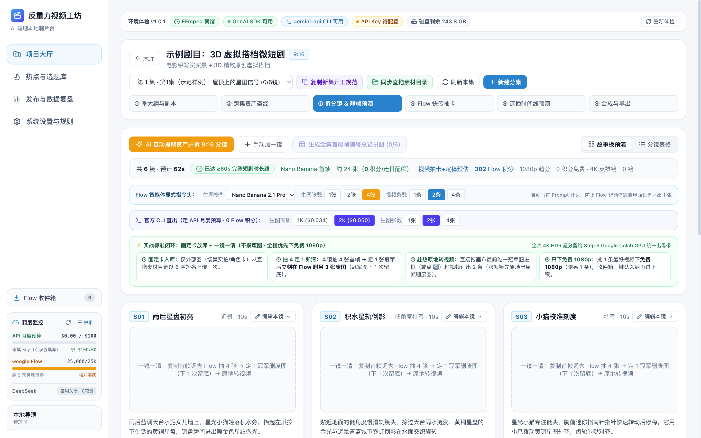
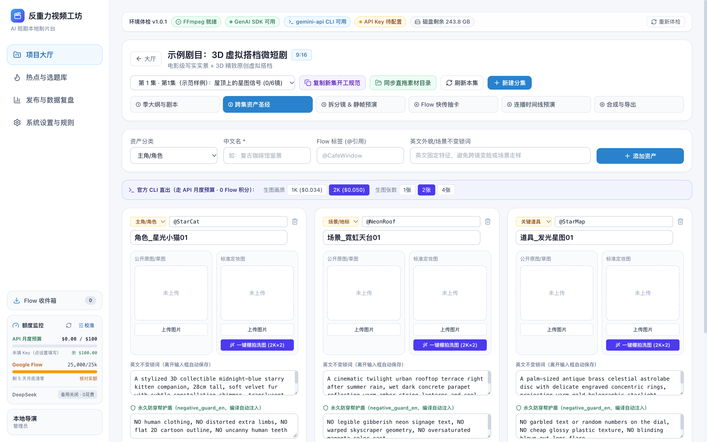
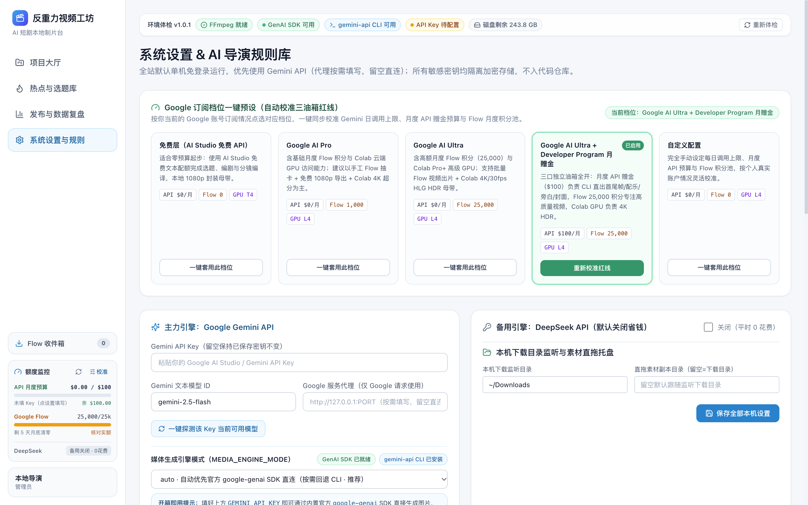
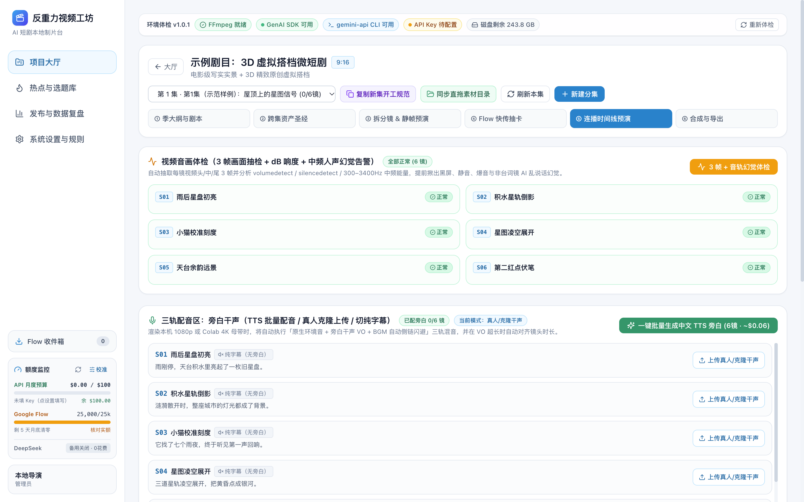
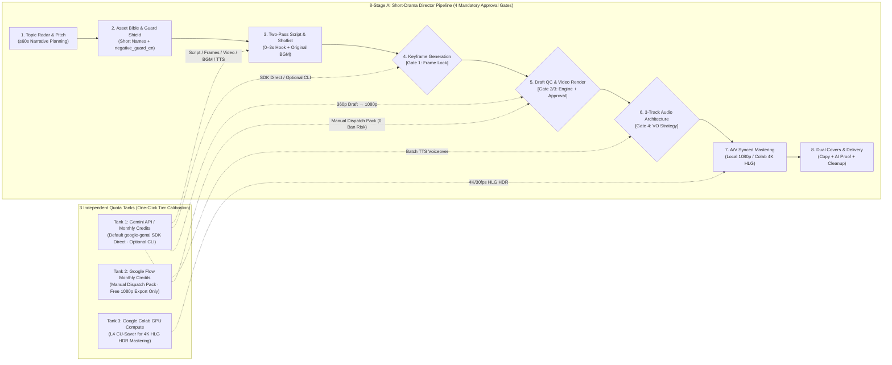

# Antigravity Video Studio

[](https://github.com/a78c7/antigravity-video-studio/releases)
[](LICENSE)
[](pyproject.toml)
[](#quick-start-b-manual-cli-launch-macos--linux--windows)
[](https://github.com/a78c7/antigravity-video-studio/actions/workflows/ci.yml)

**Language / 语言**：[简体中文](README.md) | **English**

> **Unofficial Community Disclaimer**: This is an independent, community-built open-source tool and is **not** affiliated with, endorsed by, or officially connected to Google or Antigravity.
>
> **A local-first, end-to-end AI short-drama production studio built specifically for Google Gemini & Antigravity subscribers.**
>
> Unify and maximize every part of your monthly Google subscription — **Gemini API credits, Google Flow monthly credits, and Google Colab GPU compute** — with **zero ban risk, smarter credit budgeting, and no tedious manual timeline editing**. Run the entire pipeline from one local desk: **Topic Discovery → Asset Bible & Anti-Drift Guardrails → Script & Storyboarding → Keyframe Generation → 360p Draft / 1080p Final Video → 3-Track Audio & Auto-Aligned Voiceover Mixing → Colab 4K HLG HDR Mastering with Safe-Zone Subtitles → Dual-Aspect Covers & AI Originality Proof**.

> [!IMPORTANT]
> **AGPL-3.0 Creator Copyright Assurance**: You retain **100% copyright ownership** over all scripts, character sheets, storyboard clips, music, voiceovers, covers, and final videos you create with this tool. You are free to publish and monetize your works commercially (YouTube, TikTok, Instagram Reels, Douyin, WeChat Channels, Xiaohongshu, Bilibili, etc.) — **your creative output is never subject to AGPL-3.0**. AGPL-3.0 only applies if you modify this software's source code and host it as a network service (SaaS).

---

## WebUI Preview

> Captured locally at `1440×900` desktop viewport using the built-in neutral demo project (`3D Companion Short Drama` — zero personal data). *Note: The current WebUI copy is primarily in Simplified Chinese (`zh-CN`), while compiled image/video prompts are generated in English for maximum Google model fidelity.*

| Producer Workspace & Storyboard Overview | Cross-Episode Asset Bible & Anti-Drift Guard |
| :---: | :---: |
|  |  |
| **6-Step Pipeline × Credit Estimator × Shot-by-Shot Flow**: Manage scripts, keyframes, explicit Flow prompt headers, and 1K/2K SDK/CLI direct generation | **Zero Face Drift & Continuity Loss**: Persistent `@Tag` anchors, immutable English visual descriptors, `negative_guard_en` shields, and studio turnaround cards |

| System Settings · 5 Subscription Presets & 3-Tank Monitor | Audio/Video Hallucination QC & 3-Track Voiceover Desk |
| :---: | :---: |
|  |  |
| **Environment Health Lights × 5 Google Tier Presets**: One-click calibration for API monthly credits, Flow pool, Colab GPU, and SDK/CLI dual engine mode | **3-Frame + Audio Hallucination QC × 3-Track Mixing**: Catch black frames, silence, and unwanted AI speech early; batch TTS, custom VO upload, and duration sync |

<!-- Demo Video Placeholder (for future manual upload; no broken links):
To showcase a 15–25s end-to-end demo clip, drag-and-drop an MP4 into a GitHub Issue/PR editor to obtain a hosted user-attachments URL, then uncomment below:

### End-to-End Demo Clip (15–25s)

https://github.com/user-attachments/assets/<replace-with-uploaded-demo-video-id>
-->

---

## 3 Independent Quota Tanks × 8-Stage AI Director Pipeline



---

## What's New in v1.0.1

- **Official `google-genai` Python SDK Direct Engine**: No external CLI setup required — paste your `GEMINI_API_KEY` in Settings to generate images, videos, original music, and TTS voiceovers out of the box. The `gemini-api` CLI remains supported as an optional/fallback channel (`MEDIA_ENGINE_MODE`: `auto` / `sdk` / `cli`).
- **Precision Voiceover-to-Shot Sync**: Automatically handles voiceovers longer than their video clip via `pad` (smooth last-frame freeze extension with downstream timeline ripple so trailing speech is never clipped or overlapped) or `speed` (up to `1.20x` subtle tempo speedup + freeze-frame fallback), keeping `.srt` subtitles tightly synced.
- **Lightweight SQLite Async Job Queue**: Image/video generation, BGM, batch TTS, dual-aspect covers, local 1080p renders, and Colab 4K jobs run asynchronously with real-time progress bars, page-refresh persistence, cancellation, and concurrent multi-shot work.
- **Four Flagship WebUI Capabilities Visualized**: One-click web controls for **Numbered Keyframe Contact Sheet**, **3-Frame + Audio Hallucination QC**, **One-Click Batch TTS Voiceover**, and **Per-Shot Custom Voice Upload / Subtitle-Only Toggle**.
- **Zero-Friction First-Run Experience**: Built-in environment health bar (FFmpeg / GenAI SDK / CLI / disk space), dismissible 3-step onboarding bar, and a complete neutral demo project (1 series + 3 guarded assets + 1 episode + 6 shots).

---

## Why Build This?

If you subscribe to Google AI Pro / Ultra or receive Google Developer Program monthly API credits, you have probably run into these pain points:

- **Siloed Quota Tanks**: API credits, Flow monthly credits, and Colab compute live in separate worlds — either unused credits expire at month-end, or a few accidental 50-credit Flow 4K upscales wipe out your pool;
- **Cross-Shot Character Drift**: Copy-pasting prompts manually makes it easy to drop key character constraints, causing faces, outfits, and proportions to morph between shots;
- **Chaotic UUID Downloads**: Dozens of draft takes and final renders pile up in `~/Downloads` with random hashes and zero shot mapping;
- **Painful Manual Editing**: Repeatedly building 3 audio tracks (ambient SFX + voiceover + BGM), stretching shots to fit voiceovers, configuring audio ducking, and keeping vertical subtitles inside mobile safe zones.

**Antigravity Video Studio** combines a lightweight single-process local Web studio (**FastAPI + SQLite WAL**) with a dedicated **Antigravity Director Skill (`skills/agvs-director`)**: **AI handles the heavy lifting (research, scriptwriting, concurrent takes, visual/audio QC, mixing, and safe-zone subtitles), while pausing at every creative or credit-spending milestone for your approval.**

---

## 3 Independent Quota Tanks (Calibrated by Subscription Tier)

Includes **5 built-in Google subscription presets** (*Free AI Studio / Google AI Pro / Google AI Ultra / AI Ultra + Developer Monthly Credits / Custom*) to calibrate spending guardrails in one click:

| Quota Tank | Source | Primary Role | Cost-Saving & Risk Guardrail |
| :--- | :--- | :--- | :--- |
| **Tank 1: Gemini API / Monthly Credits** | AI Studio Free Tier or Google Developer Program Monthly Credits | Script/storyboard planning + **official `google-genai` Python SDK direct generation** (keyframes, 360p drafts, 1080p finals, original BGM, TTS; optional `gemini-api` CLI) | Draft cheaply at 360p + run 3-frame/audio QC before upgrading approved shots to 1080p; warns automatically when approaching budget thresholds to switch to Manual Flow. |
| **Tank 2: Google Flow Monthly Credits** | Google AI Pro / Ultra Monthly Credits | Video generation under **Manual Flow Mode** | Packages numbered keyframes + per-shot prompts cleanly; export **free 1080p** only and never burn 50 credits/shot on Flow 4K. |
| **Tank 3: Google Colab GPU Compute** | Colab Pro / Pro+ Compute Units (CU) | Final **4K/30fps + 10-bit HLG HDR + 24%–26% bottom safe-zone subtitle** mastering | Defaults to **L4 GPU** (fast startup, low CU cost, ~`0.4 CU`/episode) with automatic VM teardown on completion; gracefully falls back to local 1080p rendering without Colab. |

> **Tip for Developer Monthly Credits**: After claiming your Google Developer Program monthly API credit (included with Google AI Pro / Ultra), link a **Billing Account** in Google AI Studio so the monthly credit automatically applies to `GEMINI_API_KEY` usage.
>
> All model IDs, `MEDIA_ENGINE_MODE` (`auto` / `sdk` / `cli`), and estimated unit prices are editable live in WebUI **Settings** — adapt smoothly to new Google models with zero code edits.

---

## Safety & UX Guardrails

- **Zero Ban Risk**: Never scrapes, injects cookies into, or automates `flow.google.com`. Manual Flow mode solely generates local numbered dispatch packs; you generate & download on the official Flow web app while the local studio watches and claims files automatically.
- **Local-First & Isolated Secret Storage**: All projects, databases, and media stay in local `data/` and are never uploaded without your action. API keys are stored in macOS Keychain (`antigravity-video-studio`) on macOS, or restricted `.secrets.env` (`0600`) / environment variables on Windows & Linux — never echoed in logs or code.
- **Split-Routing Optional Proxy**: Direct connection by default (proxy blank). If you configure a local proxy URL, **only Google domains route through the proxy**, while optional secondary endpoints remain direct.
- **Truly Cross-Platform & Lightweight**: Supports **macOS, Windows, and Linux** with prebuilt static frontend assets (no Node.js required for end users) and automatic hardware encoder detection (Apple VideoToolbox / NVIDIA NVENC / graceful software fallback).

---

## Quick Start A: Guided Setup with Antigravity AI (Recommended)

If you use **Antigravity**, skip manual `.env` editing and let the bundled Director Skill walk you through interactive setup:

### Step 1: Clone & Install the Director Skill

```bash
git clone https://github.com/a78c7/antigravity-video-studio.git
cd antigravity-video-studio
```

Open this repository as your Antigravity workspace, or copy the skill to your global skills directory:

```bash
# macOS / Linux
mkdir -p ~/.gemini/config/skills
cp -R skills/agvs-director ~/.gemini/config/skills/agvs-director
```

```powershell
# Windows PowerShell
New-Item -ItemType Directory -Force "$HOME\.gemini\config\skills" | Out-Null
Copy-Item -Recurse -Force "skills\agvs-director" "$HOME\.gemini\config\skills\agvs-director"
```

### Step 2: Send One Prompt to Antigravity

Send in chat:

> **"Please read `skills/agvs-director/SKILL.md` and walk me through initializing Antigravity Video Studio."**

Antigravity launches **Stage 0 (Interactive Setup Wizard)** to configure:

1. Your **Google subscription tier** → auto-calibrates the 3 quota tanks;
2. **Direct connection or optional local proxy**;
3. Whether to enable or disable the **optional Chinese Top-5 Trending Radar**;
4. Whether to connect **Google Colab cloud 4K HDR rendering** (or start with local 1080p);
5. **Local single-user mode** vs. **optional self-hosted team collaboration**;
6. Saving your `GEMINI_API_KEY` securely in the local WebUI (activating SDK direct mode) and launching the studio.

### Step 3: 8-Stage AI Director Workflow (4 Mandatory Approval Gates)

Tell Antigravity any genre you want to produce (drama, sci-fi, pets, food, travel, explainers, etc.), and it follows the structured SOP:

1. **Topic Radar & Pitch** → Multi-source ideation, viral structure adaptation, ≥60s arc planning;
2. **Asset Bible & Anti-Drift Shield** → Short asset tags + `negative_guard_en` + cross-episode continuity ledger;
3. **Two-Pass Script & Storyboarding** → Writer draft + ruthless editor polish + original BGM prompt + 9:16 shotlist;
4. **Keyframe Generation (Gate 1: Frame Approval)** → Tiered generation + visual screening + numbered contact sheet;
5. **Dual-Mode Video Generation (Engine Choice + Gate 2/3: QC & Approval)** → SDK/CLI 360p draft QC → 1080p final, or Manual Flow dispatch pack;
6. **3-Track Audio Architecture (Gate 4: Voiceover Choice)** → Ambient SFX + official TTS / custom voiceover / subtitle-only + automatic BGM sidechain ducking;
7. **A/V Synced Mastering** → Auto VO duration alignment (`pad`/`speed`) + local 1080p review + Colab 4K/30fps 10-bit HLG HDR safe-zone mastering (or `.fcpxml` export);
8. **Delivery & Cleanup** → 9:16 & 3:4 covers, multi-platform publishing copy, *AI Originality Production Proof*, and one-click draft cleanup.

---

## Quick Start B: Manual CLI Launch (macOS / Linux / Windows)

### Prerequisites

- **Python 3.12+** (if `uv` is installed, startup scripts automatically use it for fast environment setup)
- **FFmpeg** (required for local assembly, 3-track mixing, VO sync, and A/V QC):
  - macOS: `brew install ffmpeg`
  - Windows: `winget install Gyan.FFmpeg`
  - Ubuntu / Debian: `sudo apt update && sudo apt install -y ffmpeg`
- *Optional*: Official **`google-genai` Python SDK** is bundled by default (just add `GEMINI_API_KEY`); optionally install `gemini-api` CLI or `google-colab-cli` for CLI fallback / cloud 4K HDR mastering.

### One-Click Launch

**macOS / Linux:**

```bash
chmod +x start.sh
./start.sh
```

**Windows (Double-click `start.bat` recommended):**

- **Option 1 (Recommended — zero execution-policy prompts)**: Double-click **`start.bat`** in the repository root (auto-configures UTF-8, bypasses PowerShell execution policy, and pauses on errors for easy reading);
- **Option 2 (PowerShell)**:

```powershell
.\start.ps1
```

> If PowerShell blocks `.\start.ps1`, run `Set-ExecutionPolicy -Scope CurrentUser RemoteSigned` once, or simply double-click `start.bat`.

First launch automatically creates `.venv`, installs dependencies, checks port availability, and opens `http://127.0.0.1:8765` once healthy (customize port via `AGVS_PORT`, disable auto-browser via `AGVS_NO_BROWSER=1`).

> Prebuilt static frontend assets are included in `backend/static/`; you only need Node.js (`cd frontend && npm install && npm run build`) if you customize the React frontend.

---

## Optional Modules

- **Trending Topic Radar (Toggleable · Graceful Fallback)**: Built-in direct fetchers for 5 major Chinese trending feeds (Douyin, Toutiao, Baidu, Bilibili, Weibo) with automatic cache fallback on rate limits. **International or original-IP creators can disable `ENABLE_HOT_FEEDS` with one click in Settings** for a completely clean workspace.
- **Self-Hosted Multi-User Collaboration**: Runs locally without login by default. For remote script review, cover voting, and feedback with collaborators, see [deploy/self-hosted/README.md](deploy/self-hosted/README.md) for a hardened Linux VPS template (zero Google credentials on the server, mandatory login, optional `ntfy` push notifications).

---

## Roadmap & Anti-Roadmap

### Roadmap

- **Finer Post-Production Controls**: Per-shot BGM volume envelope tweaks, bilingual subtitle templates, and expanded TTS voice previews;
- **Enhanced Mobile Review**: Smoother mobile review and revision diffing in self-hosted collaboration mode;
- **Continuous Google Model Alignment**: Day-one compatibility with upcoming Gemini / Imagen / Veo / Lyria official SDK capabilities without requiring code rewrites.

### Anti-Roadmap (What We Intentionally Won't Build)

To protect creator accounts and preserve zero-ops simplicity, this project **deliberately refuses** to build:

1. **No `flow.google.com` scraping, headless browser clicking, or reverse-engineered APIs**: Zero-ban red line — Manual Flow strictly builds local dispatch packs and watches local downloads;
2. **No heavy distributed stacks (Redis / Celery / Kubernetes)**: Stays single-process FastAPI + SQLite WAL so any creator can double-click and run locally;
3. **No auto-posting or auto-commenting bots for social platforms**: Multi-platform copy and comment reply drafts are generated locally for human review and manual publishing;
4. **No bloated multi-vendor provider sprawl**: Laser-focused on extracting maximum value and stability from the Google Gemini / Flow / Colab / Antigravity ecosystem.

---

## Repository Structure

```text
antigravity-video-studio/
├── backend/                 # FastAPI backend, SQLite WAL layer, SDK/CLI media engine, async jobs & prebuilt static UI
├── frontend/                # React + TypeScript + Vite frontend source
├── docs/
│   └── screenshots/         # WebUI showcase screenshots (1440×900 Retina PNGs)
├── skills/
│   └── agvs-director/       # Antigravity Stage 0 setup wizard + 8-stage AI Director Skill
├── tests/
│   └── test_smoke.py        # Isolated, zero-side-effect pytest smoke & regression suite
├── deploy/
│   └── self-hosted/         # Optional Linux VPS self-hosted collaboration templates
├── scripts/
│   └── privacy_check.py     # Zero-dependency secret & privacy leak scanner
├── .github/                 # CI workflows (Linux + Windows), Issue & PR templates
├── start.sh                 # macOS / Linux one-click launcher
├── start.ps1 / start.bat    # Windows one-click launcher (UTF-8 hardened)
├── pyproject.toml           # Python package metadata & minimal dependencies
├── .env.example             # Sanitized environment template
├── README.md                # Simplified Chinese README
├── README.en.md             # English README
└── LICENSE                  # GNU AGPL-3.0 full text
```

---

## Privacy Scanner & Automated Tests

Includes a pure-stdlib privacy/secret scanner and isolated `pytest` regression suite:

```bash
# Run privacy & secret leak check (supports optional gitignored .privacy-blocklist.local)
python3 scripts/privacy_check.py
# Optional: enable as a git pre-commit hook
ln -sf ../../scripts/privacy_check.py .git/hooks/pre-commit

# Run isolated smoke tests (uses temporary directories, never touches local data/)
pip install -e ".[dev]"
pytest -q tests/test_smoke.py
```

---

## License & Disclaimer

- **License**: Source code is licensed under **GNU Affero General Public License v3.0 (AGPL-3.0)** — see [LICENSE](LICENSE). If you modify the source code and provide it as a network service, you must make your modified source available under AGPL-3.0.
- **Creator Ownership**: **All scripts, images, videos, audio tracks, covers, and final renders generated using this software belong 100% to the creator for unrestricted commercial use and monetization, completely outside AGPL-3.0 copyleft scope.**
- **Disclaimer**:
  1. This is an unofficial community open-source tool with no affiliation with Google or Antigravity.
  2. Users are responsible for complying with the Terms of Service and quota policies of Google Gemini API, Google Flow, Google Colab, and all publishing platforms.
  3. Creators are solely responsible for ensuring their scripts, characters, audio, and visuals comply with applicable laws and do not infringe third-party copyrights, portrait rights, or trademarks.
