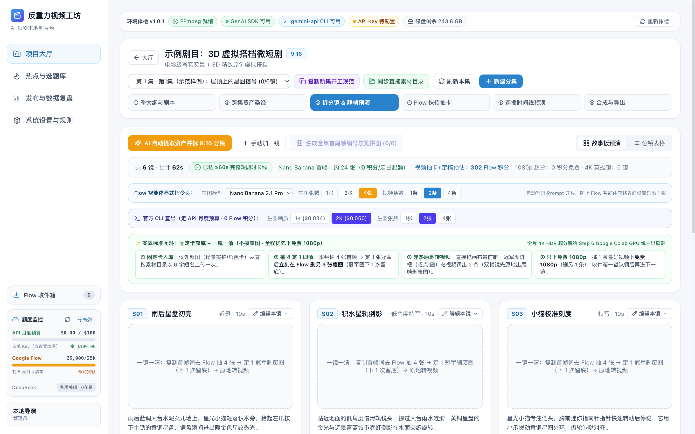
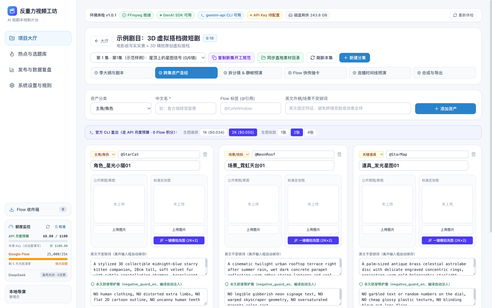
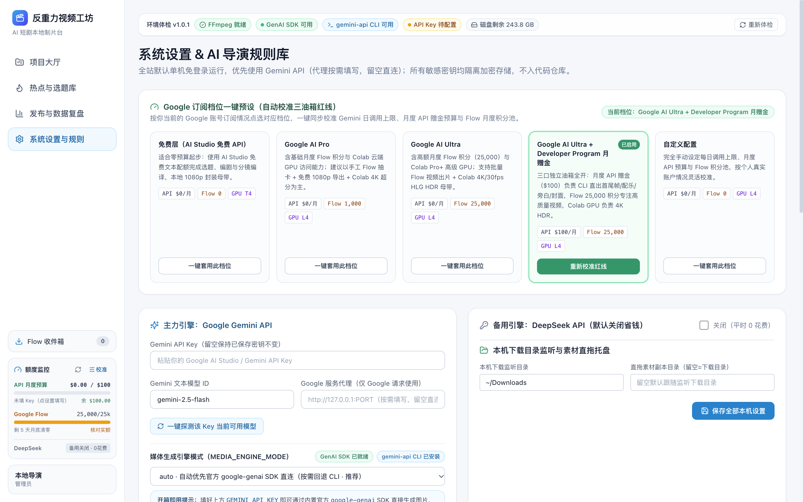
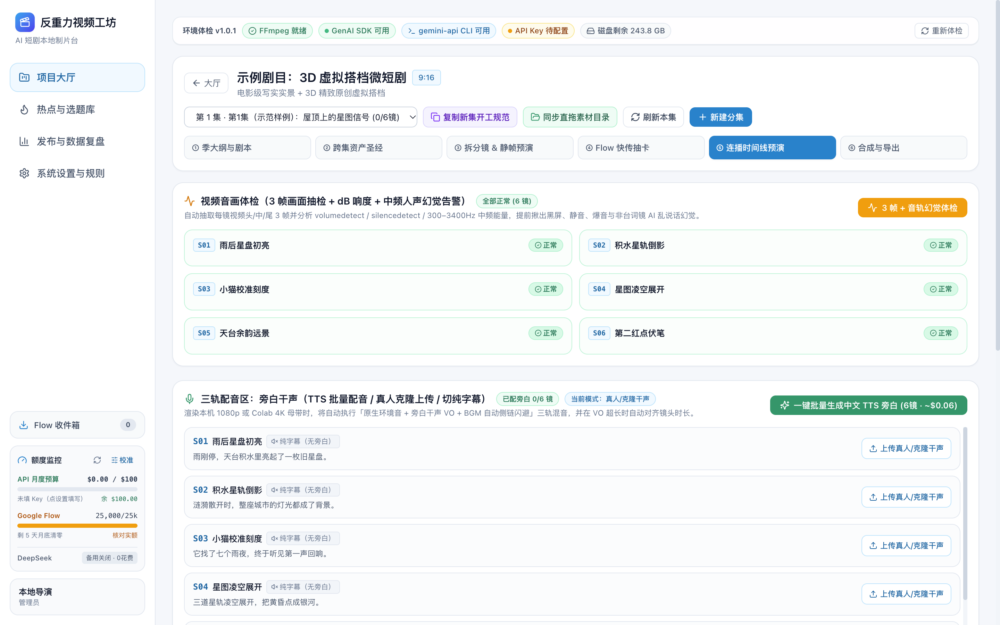
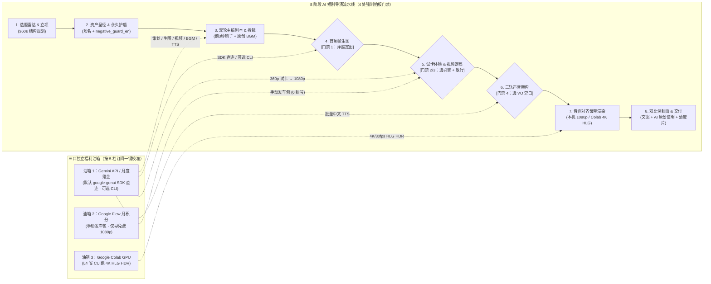

# 反重力视频工坊（Antigravity Video Studio）

[](https://github.com/a78c7/antigravity-video-studio/releases)
[](LICENSE)
[](pyproject.toml)
[](#快速上手-b纯命令行手动启动macos--linux--windows)
[](https://github.com/a78c7/antigravity-video-studio/actions/workflows/ci.yml)

**语言 / Language**：**简体中文** | [English](README.en.md)

> **社区非官方声明**：本项目为非官方社区开源工具，与 Google / Antigravity 官方无任何隶属关系。
>
> **专为 Google Gemini / Antigravity（反重力）订阅用户打造的本地 AI 短剧全流程制片台。**
>
> 把你每月订阅附带的 **Gemini API 赠金、Google Flow 网页积分、Google Colab GPU 算力** 彻底串联榨干 —— **0 封号、省积分、告别剪映手搓**，一条龙跑通「选题 → 资产防穿帮 → 剧本分镜 → 首尾帧定图 → 360p 试卡/1080p 定稿 → 三轨配音与音画对齐混音 → Colab 4K HLG HDR 安全区字幕母带 → 双比例封面与 AI 原创证明」。

> [!IMPORTANT]
> **AGPL-3.0 创作者版权定心丸声明**：你使用本工具生成的剧本、角色图、分镜视频、配乐、旁白、封面与成片，其版权 **100% 归你本人所有**，可自由商业发布与变现（抖音、微信视频号、小红书、B站、YouTube 等），**完全不受 AGPL-3.0 协议传染**。AGPL-3.0 仅约束修改本项目源码后对外提供网络托管（SaaS）服务的行为。

---

## 界面实拍预览（WebUI）

> 以下 4 张均为内置中立示范剧目（`示例剧目：3D 虚拟搭档微短剧`）在 `1440×900` 桌面端下的纯本地实拍界面：

| 主制片工作台与分镜/操作总览 | 跨集资产圣经与永久防穿帮护盾 |
| :---: | :---: |
|  |  |
| **6 步流水线 × 预算器 × 一镜一清闭环**：统筹剧本、首尾帧、Flow 显式指令头与 SDK/CLI 1K/2K 直出 | **跨集不吃书、跨镜不变脸**：固定 `@Tag`、英文不变锁词、永久防穿帮护盾 `negative_guard_en` 与一键棚拍洗图 |

| 系统设置 · 5 档订阅预设与三油箱监控 | 音画幻觉体检与三轨配音工作台 |
| :---: | :---: |
|  |  |
| **环境红绿灯 × 5 档 Google 订阅一键校准**：自动校准 API 月赠金、Flow 积分池、Colab GPU 与 SDK/CLI 双通道 | **3 帧 + 音轨幻觉体检 × 三轨旁白混音**：提前排雷黑屏/静音/AI 乱说话，支持批量中文 TTS、真人干声上传与 VO 对齐 |

<!-- 实测演示成片占位提示（后续手动上传，当前不留空死链）：
如需在 README 展示 15–25 秒实测演示成片（MP4），可在 GitHub Issue / PR 编辑框拖拽上传 MP4 获取官方托管视频链接，随后取消下方注释并替换为真实链接：

### 实测演示成片（15–25 秒完整闭环实拍）

https://github.com/user-attachments/assets/<replace-with-uploaded-demo-video-id>
-->

---

## 三口福利油箱 × 8 阶段导演门禁流程图



---

## v1.0.1 核心亮点

- **官方 `google-genai` Python SDK 直连主通道**：无需额外折腾第三方命令行，在网页「系统设置」填入 `GEMINI_API_KEY` 即可开箱一键出图、出视频、生成原创配乐与中文 TTS 旁白；原 `gemini-api` CLI 作为可选/自动回退通道完整保留（支持 `MEDIA_ENGINE_MODE` 在 `auto` / `sdk` / `cli` 间自由切换）。
- **VO 旁白与镜头时长精准对齐**：支持 `pad`（尾帧丝滑定格延展，自动顺延后续时间轴，绝不截断尾音或与下一镜叠音打架）与 `speed`（最高 1.20x 微加速 + 剩余差额尾帧定格兜底），`.srt` 字幕时间轴同步贴合人声时长。
- **SQLite 轻量异步任务队列**：生图、生视频、配乐、批量 TTS、双比例封面、本机 1080p 渲染与 Colab 4K 派发均支持异步队列运行与实时进度条，刷新页面不丢进度、支持随时取消、解锁多镜并发操作。
- **WebUI 四大王牌能力全面可视化**：网页直接点击即可调用「首尾帧编号总览拼图」「3 帧 + 音轨幻觉体检」「一键批量生成中文 TTS 旁白」「逐镜上传真人/克隆干声或切纯字幕」。
- **零门槛开箱体验**：内置环境体检红绿灯（FFmpeg / SDK / CLI / 磁盘空间）、首页 3 步开箱引导条，以及完整的预置示范剧目（1 剧目 + 3 个带防穿帮护盾资产 + 1 示范集 + 6 分镜）。

---

## 为什么做这个工具？

如果你订阅了 Google AI Pro / Ultra 或拥有 Google Developer Program 月度赠金，大概率遇到过这些痛点：

- **三口福利油箱各自孤立**：API 赠金、Flow 月积分、Colab 算力互相割裂，要么月底清零浪费，要么不小心花 50 积分/镜在 Flow 网页买 4K 把额度一把烧光；
- **角色跨镜变脸穿帮**：手动复制 Prompt 动不动漏掉角色特征约束，上一镜还好好的主角，下一镜就长变形、换衣服；
- **素材与命名一团糟**：网页下载一堆随机 UUID 文件，几十条试卡和定稿混在下载目录里找不着北；
- **剪映手搓太耗命**：每次都要手拉三轨（原生环境音 + 旁白 + BGM）、手动对齐超长旁白、手调人声压低配乐、手调竖屏字幕安全区防底栏遮挡。

**反重力视频工坊**用一个轻量单进程本地 Web 制片台（FastAPI + SQLite WAL）搭配 **Antigravity 专属导演 Skill（`skills/agvs-director`）** 解决整条链路：**AI 干脏活累活（搜选题、写分镜、并发抽卡、看图排雷、听音查幻觉、混音压字幕），所有审美与花钱节点弹出选择题交给你拍板。**

---

## 三口独立福利油箱分工（按订阅档位一键校准）

内置 **5 档 Google 订阅预设**（免费 AI Studio / Google AI Pro / Google AI Ultra / AI Ultra + API 月赠金 / 自定义），一键校准三口油箱红线，互不混用、不悄悄超支：

| 油箱 | 来源 | 主力分工 | 省钱与风控策略 |
| :--- | :--- | :--- | :--- |
| **油箱 1：Gemini API / 月度赠金** | AI Studio 免费层或 Google Developer Program 月度赠金 | 剧本/分镜策划 + **官方 `google-genai` Python SDK 直连**（填 `GEMINI_API_KEY` 即开箱出图、360p 试卡、1080p 定稿、原创配乐与中文 TTS；原 `gemini-api` CLI 为可选通道） | 先跑低价 360p 试卡 + 抽帧听音体检，确认无误再并发升 1080p；单集全套估算约 `$8–$10`，余额不足自动预警切手动 Flow。 |
| **油箱 2：Google Flow 网页积分** | Google AI Pro / Ultra 月度积分 | 「手动 Flow 模式」下生成视频镜头 | 一键打好编号首尾帧与逐镜 Prompt 发车包；仅导出 **免费 1080p**，绝不花高额积分买 Flow 4K。 |
| **油箱 3：Google Colab GPU 算力** | Colab Pro / Pro+ CU 算力 | 终版 **4K/30fps + 10-bit HLG HDR + 底部 24%–26% 安全区字幕** 超分母带 | 默认选 **L4 GPU**（抗排队、省 CU），单集约 `0.4 CU`，出片完成自动停机；未配置 Colab 时自动走本机 1080p 渲染。 |

> **激活月度 API 赠金提示**：Google AI Pro / Ultra 订阅用户在领取 Google Developer Program 月度 API 赠金后，需在 **Google AI Studio** 中绑定结算账号（Billing Account），赠金额度才会自动生效并抵扣 `GEMINI_API_KEY` 调用费用。
>
> 模型 ID、媒体引擎模式（`MEDIA_ENGINE_MODE`：`auto` / `sdk` / `cli`）与参考单价全部支持在网页「系统设置」中实时自定义，随官方模型升级零改代码平滑切换。

---

## 安全与体验红线

- **0 封号红线**：绝不使用任何非官方脚本自动化操控或爬取 `flow.google.com`；手动 Flow 模式只生成本地编号发车包，由你自己在官方网页点击生成并下载，软件自动监听认领。
- **本地优先、密钥安全存储**：全部项目、数据库与素材仅保存在本机 `data/` 目录，绝不擅自上传外部网盘；API Key 在 macOS 自动加密存入系统钥匙串（`antigravity-video-studio`），在 Windows / Linux 自动写入受控 `.secrets.env` 或环境变量，代码与日志零明文回显。
- **代理精准分流、默认不强绑**：代理配置默认留空（直连）；按需填写本地代理后，**仅 Google 域名走代理**，国内热榜与备用文本模型强制直连不偷跑代理流量。
- **真正跨平台轻量化**：同时支持 **macOS / Windows / Linux**，内置预构建静态前端（普通用户无需安装 Node.js），本地编码自动探测硬件加速（VideoToolbox / NVENC）并优雅回退软件编码。

---

## 快速上手 A：Antigravity AI 一句话引导安装与配置（强烈推荐）

如果你正在使用 **Antigravity（反重力）**，无需手工折腾任何 `.env` 文件，直接把本仓库内置的专属导演 Skill 交给 AI 即可全自动问答式起步：

### 第 1 步：拉取仓库并装载 Skill

```bash
git clone https://github.com/a78c7/antigravity-video-studio.git
cd antigravity-video-studio
```

将本仓库设为 Antigravity 当前工作区，或者把导演 Skill 复制到你的全局 Skills 目录：

```bash
# macOS / Linux
mkdir -p ~/.gemini/config/skills
cp -R skills/agvs-director ~/.gemini/config/skills/agvs-director
```

```powershell
# Windows PowerShell
New-Item -ItemType Directory -Force "$HOME\.gemini\config\skills" | Out-Null
Copy-Item -Recurse -Force "skills\agvs-director" "$HOME\.gemini\config\skills\agvs-director"
```

### 第 2 步：给 Antigravity 发一句话

直接在对话中发送：

> **“请读取 `skills/agvs-director/SKILL.md`，帮我初始化配置反重力视频工坊。”**

Antigravity 会自动启动 **「第 0 阶段｜首次开箱智能配置向导」**，通过交互式选择题一步步带你完成：

1. 选择你的 **Google 订阅档位** → 自动校准三口油箱红线与出片策略；
2. 确认 **网络直连或本地代理地址**；
3. 选择是否开启 **国内五大热榜选题雷达**；
4. 选择是否配置 **Google Colab 云端 4K HDR 渲染**（或先用本机 1080p 起步）；
5. 选择 **纯本地单机** 或 **团队自托管协同**；
6. 引导你在本地网页安全保存 `GEMINI_API_KEY`（自动激活 SDK 直连主通道）、拉起本地服务并打开浏览器。

### 第 3 步：8 阶段 AI 导演协同制片（4 处强制拍板门禁）

配置完成后，直接告诉 Antigravity 你想拍什么题材（剧情、科幻、萌宠、美食、城市故事、科普皆可），它会严格按 SOP 协同推进：

1. **选题雷达与立项** → 多路搜题、爆款结构对标转译、≥60 秒结构规划；
2. **资产圣经与永久防穿帮** → 短名规范 + `negative_guard_en` 永久护盾 + 防吃书账本；
3. **剧本共创与分镜拆解** → 初稿 + 毒舌主编二次精修 + 原创配乐 + 9:16 分镜；
4. **首尾帧生图（门禁 1 弹窗定图）** → 分级抽卡 + AI 逐张看图排雷 + 编号总览拼图；
5. **视频双模生成（引擎选择 + 门禁 2 弹窗放行）** → SDK/CLI 360p 试卡体检/1080p 定稿 或 手动 Flow 发车包；
6. **三轨声音架构（门禁 4 弹窗选配音）** → 原生环境音 + 官方 TTS/真人干声/纯字幕 + BGM 侧链自动闪避；
7. **音画对齐母带渲染** → VO 超长尾帧定格/微加速对齐 + 本机 1080p 初审 + Colab 4K/30fps 10-bit HLG HDR 安全区字幕终版（或导出 `.fcpxml` 兜底）；
8. **交付收口** → 9:16 & 3:4 双比例封面、多平台文案、《AI 原创制作证明》、一键清废片。

---

## 快速上手 B：纯命令行手动启动（macOS / Linux / Windows）

### 前置依赖

- **Python 3.12+**（如已安装 `uv`，启动脚本会自动加速建环境装依赖）
- **FFmpeg**（用于本地剪辑、三轨混音、音画对齐与音画体检）：
  - macOS：`brew install ffmpeg`
  - Windows：`winget install Gyan.FFmpeg`
  - Ubuntu / Debian：`sudo apt update && sudo apt install -y ffmpeg`
- *可选*：默认已内置官方 **`google-genai` Python SDK**（填 `GEMINI_API_KEY` 即可开箱出图/出视频/配乐/TTS）；如习惯命令行通道可选装 `gemini-api` CLI；如需云端 4K HDR 渲染可选装官方 `google-colab-cli`。

### 一键启动

**macOS / Linux：**

```bash
chmod +x start.sh
./start.sh
```

**Windows（推荐直接双击 `start.bat`）：**

- **方式 1（推荐，零执行策略报错）**：直接双击项目根目录的 **`start.bat`**（自动切换 UTF-8 并绕过 PowerShell 执行策略，报错时停留窗口方便查看排错提示）；
- **方式 2（PowerShell 命令行）**：

```powershell
.\start.ps1
```

> 若在 PowerShell 中直接运行 `.\start.ps1` 提示「在此系统上禁止运行脚本」，先执行一次 `Set-ExecutionPolicy -Scope CurrentUser RemoteSigned` 放行，或直接改用双击 `start.bat`。

首次运行会自动创建 `.venv` 虚拟环境、安装依赖、检测端口占用，并在服务就绪后自动打开 `http://127.0.0.1:8765`（可通过环境变量 `AGVS_PORT` 修改端口，设 `AGVS_NO_BROWSER=1` 禁止自动弹浏览器）。

> 仓库已包含预构建的 `backend/static/` 网页文件；仅当你二次开发前端源码时才需执行 `cd frontend && npm install && npm run build`。

---

## 可选功能模块

- **国内五大热榜选题雷达（可开关 · 优雅降级）**：内置抖音、今日头条、百度、B站、微博直连热榜抓取，默认开启，第三方源偶发限流/超时时自动回退最近成功缓存并展示温和黄条提醒；做纯原创或海外题材时，可在网页「系统设置」中一键关闭 `ENABLE_HOT_FEEDS`。
- **可选自托管多人协作模式**：默认纯本地单机免登录运行；如果需要多人远程审片、共同改剧本/分镜或投票选封面，可按 [deploy/self-hosted/README.md](deploy/self-hosted/README.md) 将协作脱敏版部署到自有 Linux 服务器（零 Google 凭据上云、强制账号登录），并可按需接入开源 `ntfy` 接收实时审片推送。

---

## Roadmap 与 刻意不做（Anti-Roadmap）

### Roadmap（后续迭代方向）

- **更细腻的音画后期体验**：支持分镜级配乐音量包络微调、可选中英双语字幕样式模板、更多预设配音音色试听；
- **跨设备轻协作体验增强**：优化自托管协作端的移动端审片交互与版本对比视图；
- **持续紧跟 Google 官方模型演进**：第一时间适配新版 Gemini / Imagen / Veo / Lyria 官方 SDK 能力，保持零改代码平滑升级。

### 刻意不做（Anti-Roadmap）

为了守住创作者账号安全与开箱即用的轻量体验，以下事情本项目**刻意不做**：

1. **绝不做 `flow.google.com` 自动化爬取、无头浏览器代点或逆向接口**：死守 0 封号红线，手动 Flow 永远只做本地编号发车包与下载目录自动认领；
2. **绝不做重分布式集群（Redis / Celery / Kubernetes）**：坚持单进程 FastAPI + SQLite WAL 轻量本地架构，双击即用、零运维负担；
3. **绝不做第三方短视频平台自动发布/自动发评插件**：所有多平台文案与高情商评论回复仅在本地生成草稿，由创作者人工审核复制发布；
4. **绝不做多厂商模型大杂烩拼盘**：专注把 Google Gemini / Flow / Colab / Antigravity 生态的每一分订阅额度榨干磨精，不为了凑清单牺牲稳定性。

---

## 仓库目录结构

```text
antigravity-video-studio/
├── backend/                 # FastAPI 后端、SQLite 数据层、SDK/CLI 媒体引擎、异步任务中心与预构建静态页
├── frontend/                # React + TypeScript + Vite 前端源码
├── docs/
│   └── screenshots/         # WebUI 实拍展示截图（1440×900 高清 PNG）
├── skills/
│   └── agvs-director/       # Antigravity 专属开箱向导 + 8 阶段 AI 短剧导演 Skill
├── tests/
│   └── test_smoke.py        # 零副作用自动化冒烟与回归测试套件（pytest）
├── deploy/
│   └── self-hosted/         # 可选：通用 Linux VPS 自托管多人协作参考模板
├── scripts/
│   └── privacy_check.py     # 通用开源防泄密与本地黑名单巡检脚本
├── .github/                 # CI 流水线、Issue 模板与 PR 模板
├── start.sh                 # macOS / Linux 一键启动脚本
├── start.ps1 / start.bat    # Windows 一键启动脚本（UTF-8 加固）
├── pyproject.toml           # Python 项目与精简依赖声明
├── .env.example             # 脱敏配置模板
├── README.md / README.en.md # 中英双语说明文档
└── LICENSE                  # GNU AGPL-3.0 协议全文
```

---

## 开发者防泄密巡检与自动化测试

项目内置零外部依赖的隐私巡检脚本与隔离式 `pytest` 回归测试套件：

```bash
# 隐私与防泄密巡检（支持通过被 .gitignore 忽略的 .privacy-blocklist.local 追加私有规则）
python3 scripts/privacy_check.py
# 可选：挂载为 git pre-commit hook
ln -sf ../../scripts/privacy_check.py .git/hooks/pre-commit

# 运行零副作用单测套件（使用临时目录隔离，不污染本地 data/）
pip install -e ".[dev]"
pytest -q tests/test_smoke.py
```

---

## 开源协议与免责声明

- **开源协议**：本项目源码基于 **GNU Affero General Public License v3.0（AGPL-3.0）** 开源，完整条款见 [LICENSE](LICENSE)。基于本项目修改源码并通过网络对外提供托管服务时，须按 AGPL-3.0 协议公开对应修改源码。
- **创作者作品版权**：**使用本软件创作生成的任何剧本、图片、视频、音频、封面与成片版权均 100% 归创作者本人所有，可自由商业使用与变现，不受 AGPL-3.0 传染。**
- **免责声明**：
  1. 本项目为非官方社区开源工具，与 Google / Antigravity 官方无任何隶属关系。
  2. 请遵守 Google Gemini API、Google Flow、Google Colab 及各视频发布平台的服务条款与额度规定，合理合规使用官方能力。
  3. 创作者须自行确保所创作剧本、角色、音频与画面内容合法合规，不侵犯任何第三方肖像权、著作权或商标权。
